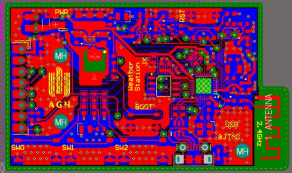
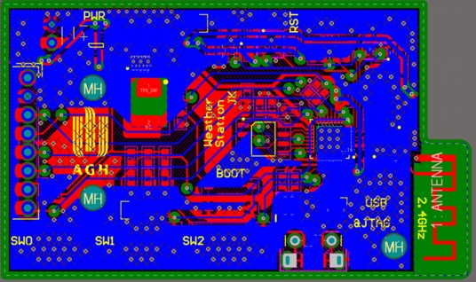
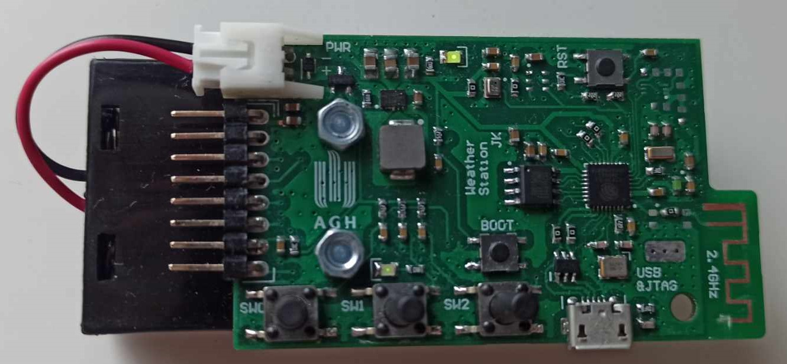
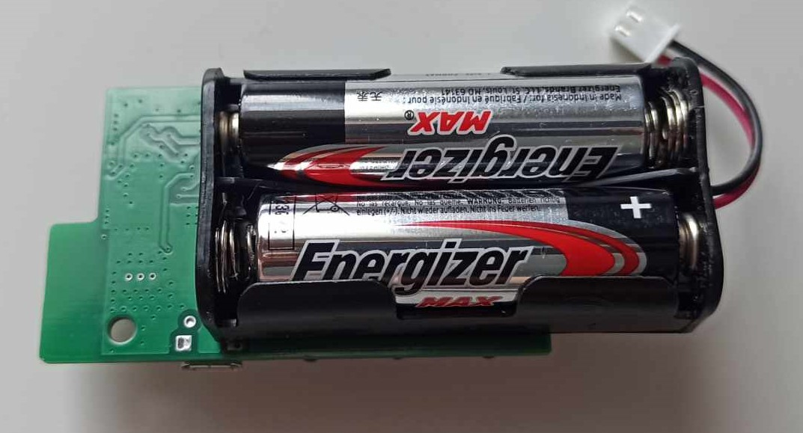

# Wireless Weather Station

A custom weather station hardware project designed and developed in Altium Designer.

The device is based on an ESP32-C3 and features multiple environmental sensors, a wireless communication interface, and a Waveshare 2.9" e-paper display (12955). The system is powered by two alkaline batteries.

## Features

* ESP32-C3 microcontroller
* Battery-powered operation using 2× alkaline batteries
* Wireless communication (WiFi/BLE)
* Waveshare 12955 e-paper display
* Environmental sensors:
  * BMP280 – temperature and atmospheric pressure
  * AHT20 – temperature and humidity
  * BH1750 – ambient light
* Custom PCB designed in Altium Designer
* Hardware prototype assembled and tested

## Hardware

The complete hardware design was developed in Altium Designer, including the schematic and PCB layout. The final prototype was manufactured and assembled to verify the hardware design.

### PCB Design

<!-- Add 3D export image here -->

<!-- Add 3D export image here -->

### Prototype

The assembled prototype is shown below. The photos show the board before the enclosure was designed or installed.

<!-- Add prototype image here -->

<!-- Add prototype image here -->

## Future Work

The next stage of the project is to develop the ESP32-C3 firmware and supporting software for collecting, processing, and displaying the measured data. The project will also be extended with a dedicated enclosure for the assembled hardware.
